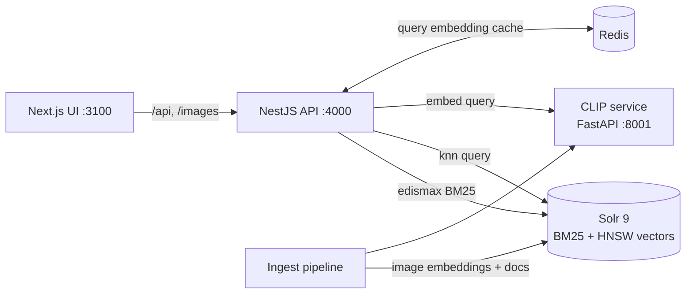

# Findwise

Visual and semantic product search over a 44k-item fashion catalog. Search by text or by photo, and compare keyword (BM25), vector (CLIP) and hybrid ranking side by side.

> Demo GIF: _coming soon_

## What it shows

- **Hybrid retrieval.** Solr BM25 and CLIP kNN run in parallel and are merged with **Reciprocal Rank Fusion**. Every result shows which retriever found it and at what rank.
- **Cross-modal search.** One CLIP model embeds both text queries and product images into the same 512-d space, so "outfit for a beach wedding" finds products from their *pictures*, not their titles.
- **Search by image and "More like this".** Upload a photo, or pivot from any product to its visual neighbours.
- **Compare mode.** Lexical and hybrid results side by side, to see where keywords fail. For example, "black formal watch" returns formal *shoes* under BM25.
- **Observability.** Per-request timing breakdown (embed / BM25 / kNN) and rolling p50/p95 latency per mode.

## Architecture



| Component | Path | Stack |
| --- | --- | --- |
| Web UI | [apps/web](apps/web) | Next.js 15, React 19 |
| Search API | [services/api](services/api) | NestJS, ioredis |
| Embeddings + ingestion | [services/ml](services/ml) | Python, FastAPI, open_clip (ViT-B/32, LAION-2B) |
| Index | Docker | Apache Solr 9 (BM25 + `DenseVectorField` HNSW) |
| Cache | Docker | Redis 7 |

### How a hybrid query works

1. The API sends the query to Solr (edismax BM25 over name and attributes) and, **in parallel**, to the CLIP service. The CLIP call hits Redis first.
2. The CLIP text vector runs as a Solr `{!knn}` query against the product **image** vectors.
3. Each retriever returns 100 candidates. They are fused with RRF, `score = Σ 1 / (60 + rank)`. RRF uses only ranks, so BM25 scores and cosine similarities never need to be normalized onto the same scale.
4. Filters (gender, type, colour, usage) apply as Solr filter queries to *both* retrievers before ranking.

## Running locally

Prerequisites: Docker, Node 20+, pnpm, [uv](https://docs.astral.sh/uv/).

```bash
pnpm install
pnpm infra:up                  # Solr :8983, Redis :6380
pnpm ingest                    # downloads dataset + CLIP, embeds and indexes ~44k products
                               # (~8 min on Apple Silicon via MPS; try `--limit 2000` first)
pnpm embedder                  # CLIP service on :8001
pnpm api                       # API on :4000 (watch mode)
pnpm web                       # UI on http://localhost:3100
pnpm eval                      # relevance report → eval/results/latest.md
pnpm grade                     # blind human grading UI on :8002; `pnpm grade --report` for agreement
```

To pass flags to ingest: `cd services/ml && uv run findwise-ingest --limit 2000`.

## API

| Method | Path | Description |
| --- | --- | --- |
| GET | `/api/search?q=&mode=lexical\|vector\|hybrid&gender=&articleType=&baseColour=&usage=&limit=` | Text search |
| POST | `/api/search/image` (multipart `image`) | Search by image |
| GET | `/api/products/:id/similar` | Visual neighbours of a product |
| GET | `/api/facets` | Filter values with counts |
| GET | `/api/stats` | Rolling p50/p95 latency per mode |

## Results

**Server-side latency**, 44,072 products, single MacBook (Apple Silicon, 8 GB RAM), sequential requests, 20 distinct queries per text mode, 12 image queries:

| Mode | p50 | p95 | Notes |
| --- | --- | --- | --- |
| Lexical (BM25) | 8 ms | 22 ms | |
| Vector (CLIP kNN) | 30 ms | 54 ms | includes uncached query embedding on MPS |
| Hybrid (RRF) | 13 ms | 24 ms | BM25 and kNN in parallel; query embedding served from Redis cache |
| Image upload | 34 ms | 219 ms | includes image decode + CLIP image encoder |

**Sanity check:** searching with a catalog image returns that exact product at rank 1.

### Relevance

50 labelled queries in three groups, scored with nDCG@10 ([full report](eval/results/latest.md)):

| Query type | Example | Lexical | Vector | Hybrid |
| --- | --- | --- | --- | --- |
| Keyword (17) | "navy blue shirt" | 0.918 | 0.740 | **0.940** |
| Synonym (16) | "trainers", "billfold" | 0.539 | **0.897** | 0.837 |
| Descriptive (17) | "something to carry my laptop in" | 0.158 | 0.689 | **0.704** |
| **All (50)** | | 0.539 | 0.773 | **0.826** |

- **Hybrid improves nDCG@10 by 53% over BM25** (0.539 → 0.826) and by 7% over vector-only search. Head to head, hybrid beats or ties BM25 on 46 of 50 queries.
- **BM25 returns no results at all for 13 of 17 descriptive queries.** Its matching rule (edismax, `mm=2<75%`) needs most query terms to appear in the product text, and "something warm for winter" never does. CLIP matches the product image instead.
- **Hybrid keeps BM25's precision on exact queries.** Vector-only search drops to 0.740 on keyword queries; hybrid reaches 0.940.
- **Weakness: on synonym queries, hybrid loses to vector-only** (0.837 vs 0.897). For queries like "shades" and "denims", BM25 contributes off-topic matches and equal-weight RRF ranks them in. Fixing this (weighted or query-aware fusion) is next on the roadmap.
- **Failure case:** "light summer dress" in vector mode returns kurtas. In Indian catalog usage "dress" often means outfit, and CLIP follows that reading; hybrid recovers about half the loss.

**Method.** A product is relevant when its catalog attributes satisfy the query's rule, for example `article_type ∈ {Laptop Bag, Backpacks, Messenger Bag, Rucksacks}` ([queries.json](eval/queries.json)). Because relevance comes from attributes, the full relevant set for every query is counted in Solr, so the ideal ranking for nDCG is exact rather than estimated from a pool. Every top-5 result is exported to [spot_check.csv](eval/results/spot_check.csv) for manual review. A manual review fixed two rules that were too narrow, and both fixes are logged in `queries.json`. Back-to-back runs give identical scores.

**Human validation.** A person graded a balanced sample of 50 (query, product) pairs blind, without seeing the automatic grade or the search mode (`pnpm grade`). The person then re-checked 4 grades that disagreed with the automatic grade and looked like mis-clicks, and changed all 4. Re-checking only disagreements can only raise agreement, so both figures are reported.

| | Relevant vs not: agreement | Cohen's κ | Exact 0/1/2 agreement |
| --- | --- | --- | --- |
| First pass | 82% | 0.15 | 68% |
| After re-check | **86%** | **0.46** | 74% |

In 9 of the 13 remaining disagreements, the automatic grader is **stricter** than the person: label noise such as a pink heel tagged "Casual Shoes", or reasonable alternatives that a rule excludes. That suggests the scores above are, if anything, slightly low. One rule (sy15, "pumps") was widened as a result. The agreement figures were measured **before** that change, so they aren't tuned to this sample. Details: [human_agreement.md](eval/results/human_agreement.md); first pass: [human_agreement_initial.md](eval/results/human_agreement_initial.md).

**Limits.** Labels describe category, colour, gender and usage, but not pattern, fabric or style, so queries like "floral print" can't be graded this way. The labels also carry noise: many boys' t-shirts are tagged `Men`, which lowers kw13 in every mode. That's left uncorrected on purpose. BM25 also indexes these same attributes, which if anything favours the lexical baseline.

Run it yourself with `pnpm eval` (API and Solr running).

## Design decisions and trade-offs

- **Solr for both BM25 and vectors.** One engine, one set of filters, no consistency problems between two stores. The cost: Solr's kNN is HNSW-only and a little less ergonomic than a dedicated vector DB.
- **Fusion in the application, not in Solr.** It keeps the per-retriever ranks visible, which the UI uses to explain results, and lets the fusion strategy change without reindexing.
- **Over-fetching for kNN.** HNSW is approximate. With `topK=5`, recall was noticeably worse than with `topK=100` trimmed to 5, so kNN always searches at least 100 candidates.
- **Embedding images, not titles.** Titles in this catalog are short and formulaic, and the images carry the signal for style and occasion queries. Titles are covered by BM25.
- **Redis is optional.** Query embeddings are cached for 24 h. If Redis is down, search continues without the cache.
- **Native embedder in development.** The CLIP service runs outside Docker so it can use the Apple GPU (MPS), about 100 images/s versus CPU-only containers.

## Roadmap

- [x] Offline evaluation: 50 labelled queries, nDCG@10 / Precision@10 / MRR per mode
- [ ] Weighted or query-aware fusion, so BM25 noise stops hurting synonym queries (measure with `pnpm eval`)
- [ ] Cross-encoder or CLIP re-ranking stage on the fused top-50
- [ ] Dockerfiles for API, embedder and web, and a hosted demo
- [ ] Load test (k6) and publish p50/p95 under concurrency

## Dataset

[`ashraq/fashion-product-images-small`](https://huggingface.co/datasets/ashraq/fashion-product-images-small), derived from the Kaggle Fashion Product Images dataset.
