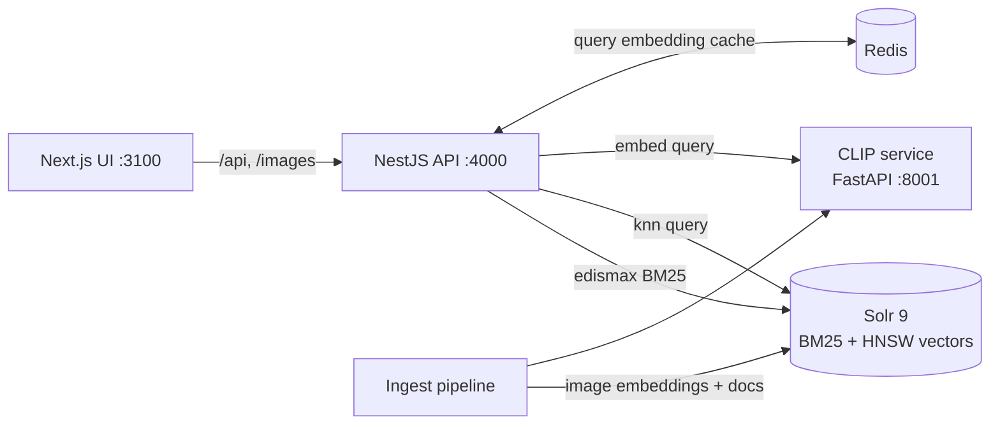

# Hybrid Product Search

Visual and semantic product search over a 44k-item fashion catalog. Search by text or by photo, and compare keyword (BM25), vector (CLIP) and hybrid ranking side by side.


## What it shows

- **Hybrid retrieval.** Solr BM25 and CLIP kNN run in parallel and are merged with **Reciprocal Rank Fusion**. Every result shows which retriever found it and at what rank.
- **Cross-modal search.** One CLIP model embeds both text queries and product images into the same 512-d space, so "outfit for a beach wedding" finds products from their *pictures*, not their titles.
- **Search by image and "More like this".** Upload a photo, or pivot from any product to its visual neighbours.
- **Compare mode.** Lexical and hybrid results side by side, to see where keywords fail. For example, "something to carry my laptop in" finds nothing under BM25.
- **Query understanding.** Detects the product type a query names ("black formal **watch**") so keyword search can't drift to whatever the modifiers match (formal *shoes*). The UI shows what was detected.
- **Observability.** Per-request timing breakdown (embed / BM25 / kNN) and rolling p50/p95 latency per mode.

## Architecture



| Component | Path | Stack |
| --- | --- | --- |
| Web UI | [apps/web](apps/web) | Next.js 15, React 19 |
| Search API | [services/api](services/api) | NestJS, ioredis |
| Embeddings + ingestion | [services/ml](services/ml) | Python, FastAPI, open_clip (ViT-B/32, LAION-2B) |
| Index | Docker | Apache Solr 9 (BM25 + `DenseVectorField` HNSW) |
| Cache | Docker | Redis 7 |

### How a hybrid query works

1. The API sends the query to Solr (edismax BM25 over name and attributes) and, **in parallel**, to the CLIP service. The CLIP call hits Redis first.
2. The CLIP text vector runs as a Solr `{!knn}` query against the product **image** vectors.
3. Each retriever returns 100 candidates. They are fused with RRF, `score = Σ 1 / (60 + rank)`. RRF uses only ranks, so BM25 scores and cosine similarities never need to be normalized onto the same scale.
4. Filters (gender, type, colour, usage) apply as Solr filter queries to *both* retrievers before ranking.

## Running locally

Prerequisites: Docker, Node 20+, pnpm, [uv](https://docs.astral.sh/uv/).

```bash
pnpm install
pnpm infra:up                  # Solr :8983, Redis :6380
pnpm ingest                    # downloads dataset + CLIP, embeds and indexes ~44k products
                               # (~8 min on Apple Silicon via MPS; try `--limit 2000` first)
pnpm embedder                  # CLIP service on :8001
pnpm api                       # API on :4000 (watch mode)
pnpm web                       # UI on http://localhost:3100
pnpm eval                      # relevance report → eval/results/latest.md
pnpm grade                     # blind human grading UI on :8002; `pnpm grade --report` for agreement
```

To pass flags to ingest: `cd services/ml && uv run --extra ingest product-search-ingest --limit 2000`.

### Running everything in Docker

The same stack runs fully containerised, with the embedder on CPU, on any machine with Docker and about 4 GB of free memory.

```bash
docker compose --profile app build
docker compose up -d solr redis
docker compose run --rm ingest       # CPU-only: ~23 images/s, so ~30 min for the full catalog
docker compose --profile app up -d   # UI on http://localhost:3100
```

Only the web UI publishes a port. Next.js forwards `/api` and `/images` to the API inside the Docker network.

## API

| Method | Path | Description |
| --- | --- | --- |
| GET | `/api/search?q=&mode=lexical\|vector\|hybrid&gender=&articleType=&baseColour=&usage=&limit=` | Text search |
| | `&fusion=rrf\|weighted\|verified&lexicalWeight=0.5` | Hybrid fusion strategy (default `rrf`); see [Fusion experiment](#fusion-experiment) |
| | `&typeAware=true\|false` | Limit keyword matches to the product type named in the query (default `true`); see [Query understanding](#query-understanding) |
| POST | `/api/search/image` (multipart `image`) | Search by image |
| GET | `/api/products/:id/similar` | Visual neighbours of a product |
| GET | `/api/facets` | Filter values with counts |
| GET | `/api/stats` | Rolling p50/p95 latency per mode |

## Results

**Server-side latency**, 44,072 products, single MacBook (Apple Silicon, 8 GB RAM), sequential requests, 20 distinct queries per text mode, 12 image queries:

| Mode | p50 | p95 | Notes |
| --- | --- | --- | --- |
| Lexical (BM25) | 8 ms | 22 ms | |
| Vector (CLIP kNN) | 30 ms | 54 ms | includes uncached query embedding on MPS |
| Hybrid (RRF) | 13 ms | 24 ms | BM25 and kNN in parallel; query embedding served from Redis cache |
| Image upload | 34 ms | 219 ms | includes image decode + CLIP image encoder |

**Sanity check:** searching with a catalog image returns that exact product at rank 1.

### Relevance

50 labelled queries in three groups, scored with nDCG@10 ([full report](eval/results/latest.md)):

| Query type | Example | Lexical | Vector | Hybrid |
| --- | --- | --- | --- | --- |
| Keyword (17) | "navy blue shirt" | 0.930 | 0.740 | **0.943** |
| Synonym (16) | "trainers", "billfold" | 0.539 | **0.897** | 0.837 |
| Descriptive (17) | "something to carry my laptop in" | 0.158 | 0.689 | **0.704** |
| **All (50)** | | 0.543 | 0.773 | **0.828** |

- **Hybrid improves nDCG@10 by 52% over BM25** (0.543 → 0.828) and by 7% over vector-only search. Head to head, hybrid beats or ties BM25 on 46 of 50 queries.
- **BM25 returns no results at all for 13 of 17 descriptive queries.** Its matching rule (edismax, `mm=2<75%`) needs most query terms to appear in the product text, and "something warm for winter" never does. CLIP matches the product image instead.
- **Hybrid keeps BM25's precision on exact queries.** Vector-only search drops to 0.740 on keyword queries; hybrid reaches 0.943.
- **Weakness: on synonym queries, hybrid loses to vector-only** (0.837 vs 0.897). For queries like "shades" and "denims", BM25 contributes off-topic matches and equal-weight RRF ranks them in. An attempt to fix this is written up under [Fusion experiment](#fusion-experiment) below; it didn't hold up on held-out queries.
- **Failure case:** "light summer dress" in vector mode returns kurtas. In Indian catalog usage "dress" often means outfit, and CLIP follows that reading; hybrid recovers about half the loss.

**Method.** A product is relevant when its catalog attributes satisfy the query's rule, for example `article_type ∈ {Laptop Bag, Backpacks, Messenger Bag, Rucksacks}` ([queries.json](eval/queries.json)). Because relevance comes from attributes, the full relevant set for every query is counted in Solr, so the ideal ranking for nDCG is exact rather than estimated from a pool. Every top-5 result is exported to [spot_check.csv](eval/results/spot_check.csv) for manual review. A manual review fixed two rules that were too narrow, and both fixes are logged in `queries.json`. Back-to-back runs give identical scores.

**Human validation.** A person graded a balanced sample of 50 (query, product) pairs blind, without seeing the automatic grade or the search mode (`pnpm grade`). The person then re-checked 4 grades that disagreed with the automatic grade and looked like mis-clicks, and changed all 4. Re-checking only disagreements can only raise agreement, so both figures are reported.

| | Relevant vs not: agreement | Cohen's κ | Exact 0/1/2 agreement |
| --- | --- | --- | --- |
| First pass | 82% | 0.15 | 68% |
| After re-check | **86%** | **0.46** | 74% |

In 9 of the 13 remaining disagreements, the automatic grader is **stricter** than the person: label noise such as a pink heel tagged "Casual Shoes", or reasonable alternatives that a rule excludes. That suggests the scores above are, if anything, slightly low. One rule (sy15, "pumps") was widened as a result. The agreement figures were measured **before** that change, so they aren't tuned to this sample. Details: [human_agreement.md](eval/results/human_agreement.md); first pass: [human_agreement_initial.md](eval/results/human_agreement_initial.md).

**Limits.** Labels describe category, colour, gender and usage, but not pattern, fabric or style, so queries like "floral print" can't be graded this way. The labels also carry noise: many boys' t-shirts are tagged `Men`, which lowers kw13 in every mode. That's left uncorrected on purpose. BM25 also indexes these same attributes, which if anything favours the lexical baseline.

Run it yourself with `pnpm eval` (API and Solr running).

### Fusion experiment

_Run before query understanding was added, so the RRF numbers here differ slightly from the table above._

**Problem.** BM25 matches the right word in the wrong sense: "denims" → *Denim* brand deodorant, "trainers" → Puma *Trainer* footballs, "shades" → *Shaded* kurta. Equal-weight RRF ranks BM25's #1 near the top whatever it is.

**Idea: semantic verification.** Before fusing, drop any BM25 match whose image is less similar to the query than the weakest of the 100 vector candidates. The deodorant scores 0.590 against a floor of 0.625 set by jeans, so it goes. The floor comes from the candidate pool itself, so there is no threshold to tune. It's compared with weighted RRF, which down-weights BM25 by a tuned factor.

**Method.** A 30-query held-out set ([queries_test.json](eval/queries_test.json)) was written and committed *before* any experiment ran. Strategies were compared on the original 50 queries; the chosen one was then run once on the held-out 30.

| Hybrid fusion | Dev (50) keyword | synonym | descriptive | **Dev all** | **Held-out (30)** |
| --- | --- | --- | --- | --- | --- |
| RRF (default) | 0.940 | 0.837 | 0.704 | 0.826 | **0.689** |
| Weighted RRF, BM25 × 0.5 | 0.883 | 0.911 | 0.694 | 0.828 | n/a |
| Weighted RRF, BM25 × 0.75 | 0.918 | 0.908 | 0.694 | 0.839 | n/a |
| Verified | 0.951 | 0.903 | 0.694 | **0.848** | 0.688 |

**Result: the dev gain didn't generalize.** Verified looked best on the dev set (+0.022), fixing every wrong-sense case above with no tuning, but it tied on the held-out set (5 queries better, 3 worse, 22 the same). The failures share one pattern: verification trusts the vector side to judge, so when CLIP is confidently wrong, correct keyword matches get thrown out.
- "light summer dress": CLIP reads "dress" as outfit and returns kurtas, so all 100 real dresses from BM25 are rejected (0.55 → 0.06).
- Held out, "kohl": vector-only scores 0.00, and verification removes the only good results (0.42 → 0.00).

Verification helps when BM25 is wrong and CLIP is right, and hurts by about as much the other way round. Fixing that needs a signal for which retriever to trust *per query*, such as a re-ranker that looks at query and product together. **RRF stays the default.** It's simpler, has lower latency (verification has to wait for the query embedding before running BM25), and ties on unseen queries. `fusion=verified` remains available for comparison. Full reports: [eval/results/fusion](eval/results/fusion).

Note on reproducibility: the very first run of a new query set can differ slightly in vector-only mode on a few queries. Every later run is identical, and all numbers above come from repeated runs. Hybrid scores matched across every run.

### Query understanding

**Problem.** For "black formal watch", BM25's matching rule needs only 2 of the 3 words. "Black formal" alone matches 1,885 products, mostly formal shoes, so plain hybrid search returned 5 shoes and 5 watches. The word that matters most, the product type, was treated like any other.

**Fix.** Detect the product type a query names and limit keyword matches to it. The vocabulary is built from the catalog at startup ([product-types.ts](services/api/src/search/product-types.ts)):
- Type names and their head words: "watch" → Watches, "flip flops" → Flip Flops. Multi-word names win ("formal shoes" → Formal Shoes only).
- Category words: "shoes" → every shoe type including heels and flats, "bag" → every bag type. Each type is assigned to the category most of its products belong to, because the catalog's own categories are noisy.
- Words that double as adjectives or other senses are excluded: "long *sleeve*" isn't Tablet Sleeve, "*lace* top" isn't Shoe Laces, "*short* dress" isn't Shorts. Body-part categories ("out of my *eyes*") are excluded too.

Vector search is left alone, so a wrong detection can't remove the right products from hybrid results.

**Evaluation.** None of the existing query sets contained this kind of query, so a third set was **generated, not hand-written**: 40 random colour + usage + type combinations from the catalog (seed 42, e.g. "black sports watches", "navy blue ethnic kurtas"). It was committed before evaluation ([queries_attribute.json](eval/queries_attribute.json)).

| Query set | BM25 off → on | Hybrid off → on | Hybrid per query (better / same / worse) |
| --- | --- | --- | --- |
| **Colour + usage + type (40, generated)** | 0.620 → **0.768** | 0.755 → **0.832** (+10%) | 16 / 22 / 2 |
| Dev (50) | 0.539 → 0.543 | 0.826 → 0.828 | 1 / 49 / 0 |
| Held-out (30) | 0.434 → 0.439 | 0.689 → 0.691 | 1 / 29 / 0 |

It fixes the class of query it targets and harms nothing elsewhere; the two small losses are re-orderings within the right product type. It's **on by default** (`typeAware=false` disables it). Caveats:
- The generated queries use the catalog's own type names, which makes detection easy; real shoppers write messier queries.
- A first version mapped "shoes" only to Casual/Formal/Sports Shoes, which dropped heels from "shoes for a party". The dev set caught that, and it led to the category rule above.
- The held-out set has now been used for two decisions (fusion and this one), so it is no longer fully fresh.

Full reports: [eval/results/type_detection](eval/results/type_detection).

## Design decisions and trade-offs

- **Solr for both BM25 and vectors.** One engine, one set of filters, no consistency problems between two stores. The cost: Solr's kNN is HNSW-only and a little less ergonomic than a dedicated vector DB.
- **Fusion in the application, not in Solr.** It keeps the per-retriever ranks visible, which the UI uses to explain results, and lets the fusion strategy change without reindexing.
- **Over-fetching for kNN.** HNSW is approximate. With `topK=5`, recall was noticeably worse than with `topK=100` trimmed to 5, so kNN always searches at least 100 candidates.
- **Embedding images, not titles.** Titles in this catalog are short and formulaic, and the images carry the signal for style and occasion queries. Titles are covered by BM25.
- **Redis is optional.** Query embeddings are cached for 24 h. If Redis is down, search continues without the cache.
- **Native embedder in development.** The CLIP service runs outside Docker so it can use the Apple GPU (MPS), about 100 images/s versus CPU-only containers.

## Roadmap

- [x] Offline evaluation: 50 labelled queries, nDCG@10 / Precision@10 / MRR per mode
- [x] Fusion experiment: weighted RRF and semantic verification, checked on a held-out set (no gain on unseen queries; RRF kept)
- [x] Query understanding: detect the product type in a query and limit keyword matches to it (+10% nDCG@10 on colour + usage + type queries)
- [ ] Detect colour and gender too ("for men", "navy"), and add shopper synonyms ("trainers", "denims") to the type vocabulary
- [ ] Per-query trust signal between BM25 and CLIP (e.g. score margins or a re-ranker), evaluated on a fresh held-out set
- [ ] Cross-encoder or CLIP re-ranking stage on the fused top-50
- [ ] Title embeddings as a third retriever, for occasion and style queries where 60×80 images can't separate a dress from a nightdress. Trade-off: CLIP's text tower is weak at text-to-text matching and BM25 already reads titles, so it needs a fresh query set to justify the extra signal
- [x] Dockerfiles for API, embedder and web
- [ ] Hosted demo
- [ ] Load test (k6) and publish p50/p95 under concurrency

## Dataset

[`ashraq/fashion-product-images-small`](https://huggingface.co/datasets/ashraq/fashion-product-images-small), derived from the Kaggle Fashion Product Images dataset.
